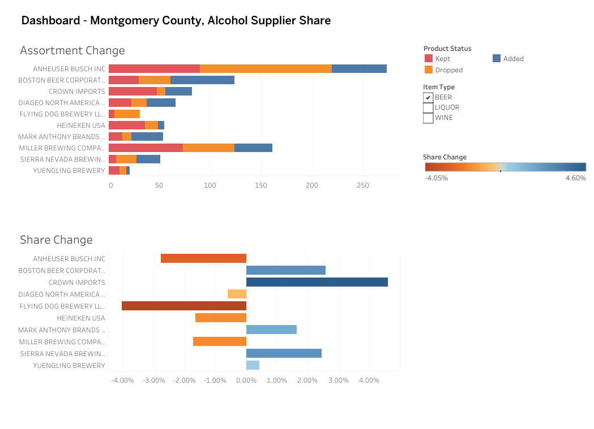
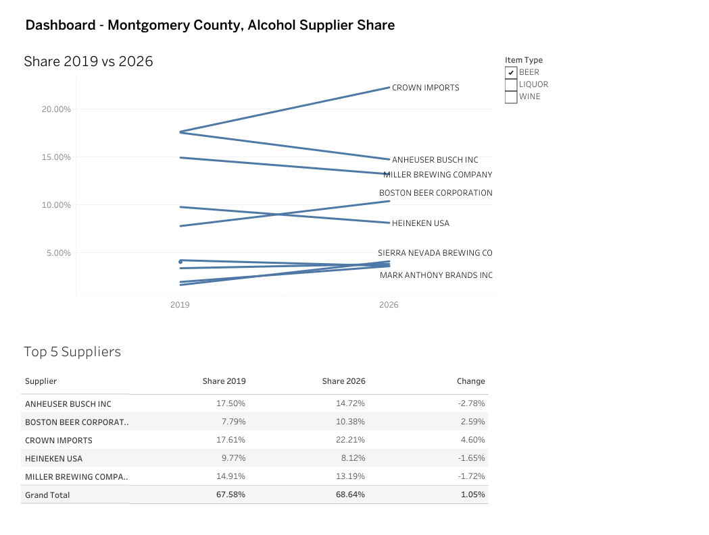

# Montgomery County Supplier Share: Summer 2019 vs Summer 2026

**[View the Tableau dashboard](https://public.tableau.com/app/profile/.nza/viz/MontgomeryCountyMD-A-BevDashboard/Dashboard-ShareChange)**




## Findings

- **Wine's biggest shift was an acquisition, not a consumer switch:** E. & J. Gallo grew from 16.7% to 25.2% of summer wine sales (+8.5 pts) while Constellation Brands fell from 13.6% to 1.8% (-11.8 pts). Gallo bought 30+ Constellation wine brands in January 2021 ([Gallo](https://www.gallo.com/press/2021-01-05-ej-gallo-winery-completes-acquisition)). Consequently, the same brands appear under Constellation in 2019 and under Gallo in 2026.
- **For Beer, Crown Imports took the lead:** Crown Imports rose from 17.6% to 22.2% (+4.6 pts) and Boston Beer from 7.8% to 10.4% (+2.6 pts), while Anheuser-Busch (-2.8), Miller (-1.7) and Heineken (-1.7) lost share.
- **Liquor: Sazerac is the biggest gainer.** Sazerac grew from 8.8% to 14.6% (+5.9 pts); Jim Beam (-5.0) and Diageo (-3.7) lost the most.
- **Assortment: liquor's growth came from new products, beer's leader grew on existing ones:** 41.4% of summer 2026 liquor sales came from products not sold in summer 2019, vs 18.0% for beer and 19.1% for wine. Sazerac, the top liquor gainer, got 42.8% of its 2026 sales from new products, and Boston Beer 47.8%. Crown Imports, the top beer gainer, got only 3.1%, so its gain came from products it already sold.
- **Concentration: beer and wine held steady, liquor spread out:** Each year's own top 5 suppliers held 67.6% → 68.6% of beer sales, 51.5% → 51.9% of wine and 48.3% → 45.0% of liquor ([concentration ratio](https://en.wikipedia.org/wiki/Concentration_ratio)). Wine's top 5 changed members (Constellation out, Jackson Family in), and liquor's top 5 lost 3.3 pts to smaller suppliers. The dashboard's Top 5 Suppliers table instead holds one set of 5 suppliers, picked by combined 2019 + 2026 sales, for both years.
- **Recommendation:** When reading supplier share across years, separate ownership changes (acquisitions/switching distributors) from real shifts in what shoppers buy. Here, the largest wine swing comes from a deal, while the beer and liquor gains (Crown, Sazerac) are the shifts worth investigating for assortment and promo planning.
## Question
How did supplier share of beer, wine and liquor sales in Montgomery County (MD) develop between summer 2019 and summer 2026, and what are the observed new products and the deletes? 

## Data
- Source: Montgomery County Open Data, *Warehouse and Retail Sales* (*dataset v76h-r7br*, [Direct Link](https://data.montgomerycountymd.gov/Community-Recreation/Warehouse-and-Retail-Sales/v76h-r7br/data_preview))
- Downloaded: 11/02/2026 *(Data may be updated by the county in the future)*
- Analysis window: June 2019 - August 2019 and June 2026 - August 2026
- Categories: Beer, Wine, and Liquor

## Cleaning log
Counts below are printed by `clean.py` (run on the 11/02/2026 file).

| Step                                                                                                                      | Rows after |
| ------------------------------------------------------------------------------------------------------------------------- | ---------- |
| Raw                                                                                                                       | 341,037    |
| Drop placeholder rows (blank retail sales: COUPON, RMS ITEM)                                                              | 341,031    |
| Keep BEER, WINE, LIQUOR (drops KEGS 11,051 · NON-ALCOHOL 2,602 · STR_SUPPLIES 471 · REF 132 · DUNNAGE 107 · blank type 1) | 326,667    |
| Drop blank-supplier store catch-all (item 172000, "STORE SPECIAL DISTRESSED RTD")                                         | 326,664    |
| Drop rows where retail sales, transfers and warehouse sales are all 0                                                     | 325,619    |
| Keep Jun 2019 - Aug 2019 and Jun - Aug 2026                                                                               | 67,163     |

**Decisions**
- **Negatives values were kept:** Values written as *"(x)"* are returns/adjustments, which were converted to *"-x"* and kept for an accurate total net down. 
- **Supplier credited at time of sale:** Sales will go towards the supplier listed in the corresponding time of sale, as crediting an item's current distributor for both 2019 and 2026 results in an inaccurate picture
- **Text normalized:** Tabs, line breaks and redundant spaces were trimmed in supplier and description. 
- **Item codes reviewed:** 1,827 codes had more than one description. 1,805 were reviewed; the other 22 are marked *not reviewed* (`data/reference/item_code_lookup.csv`): 
	- *align* = same product renamed (uses the latest description); 
	- *keep separate* = the code was reused for a different product. 
	- Evidence per code is in the `decided_by`, `evidence` and `source_url` columns 
- **Product status (Kept / Added / Dropped):** a product is *Kept* if its product key sells in both summers, *Added* if only in 2026, *Dropped* if only in 2019. Calculated in Tableau with a FIXED LOD on `product_key`.

**Item Code Review Process**

1,583 codes were aligned, 222 kept separate: each code's deciding method is in the `decided_by` column, with the evidence and source link in the decision table: `data/reference/item_code_lookup.csv`
1. **Flag codes:** Used `difflib.SequenceMatcher` to compare two strings character by character and return a score with a recommendation label: "align", "keep separate", "review".
2. **Rule checks:** Compared each description to the code's latest one on item type, size (converted to ml), package, pack count, and brand/variety (after expanding abbreviations). Result: 1,394 align, 169 keep separate, 264 unclear. Text similarity alone was tried first and dropped: it missed package changes like bottle → can.
3. **Web checks:** For unclear codes active in summer 2019 or 2026, searched for a rename or a distinct product, then checked whether the differing words appear on the other product's own page (e.g. "Madeira finished" on the Limited Release gin page). A search with no result was treated as unclear, not as "different."
4. **Primary sources and own data:** Checked the TTB label registry (COLA) for beer, spirits and sangria, and archived producer pages (Wayback Machine) for wines. In the data itself, an old name still selling under another code marked two separate products.
5. **Final calls:** Recipe tweaks were treated as the same product. The last few codes were decided by hand from packaging photos, archived pages and producer bios.


## Data gaps
The dataset covers Jun 2017 - Feb 2018, Jan 2019 - Nov 2019, Jan/Mar/Jul/Sep 2020, and Jun - Aug 2026. **Nothing exists for 2021–2025**, so this is a two-point comparison, not a trend.

## Initial Cleaning Run:
### Option 1: Python (clean.py)  

```
pip install -r requirements.txt
python clean.py            # downloads the latest data
python clean.py file.csv   # or use a file you already have
```
### Option 2: SQL (sql/clean.sql)  

The same cleaning steps are also written in SQLite, in `sql/clean.sql`. `sql/run_clean.py` loads the raw CSV and the item-code lookup into a local SQLite database (`data/sales.db`) and runs the SQL file. Then it saves the result to `data/clean/sales_clean_sql.csv`.

```
pip install -r requirements.txt
python sql/run_clean.py
```

- **If rerunning:** Delete `data/sales.db` before running it again, because the SQL creates its tables fresh.
- **Verification:** the SQL output matches `clean.py` exactly: 67,163 rows, the same product keys and the same sales totals.


How the SQL handles what pandas does with regex:
- **Negatives:** `CASE WHEN … LIKE '(%)'` turns `(0.17)` into `-0.17`.
- **Extra spaces:** SQLite has no regex replace, so the SQL replaces every double space with a single space, five passes in a row, to collapse longer runs.
- **Product key:** a `LEFT JOIN` to `item_code_lookup.csv` on item code + description. `COALESCE` falls back to the row’s own description for codes that weren’t reviewed.

Applying the item-code review: renamed products roll up under one key, and codes that weren't reviewed keep their own description.
```sql
-- Product key: apply the item-code review
-- align -> the code's latest description; keep separate or not reviewed -> the row's own description
CREATE TABLE sales_clean AS
SELECT s.YEAR, s.MONTH, s.SUPPLIER, s."ITEM CODE",
  s."ITEM CODE" || ' | ' || COALESCE(l.product_description, UPPER(s."ITEM DESCRIPTION")) AS product_key,
  COALESCE(l.product_description, UPPER(s."ITEM DESCRIPTION")) AS product_description,
  s."ITEM TYPE", s."RETAIL SALES", s."RETAIL TRANSFERS", s."WAREHOUSE SALES"
FROM step2 s
LEFT JOIN lookup l
  ON l.item_code = s."ITEM CODE"
 AND l.description = UPPER(s."ITEM DESCRIPTION");
```

